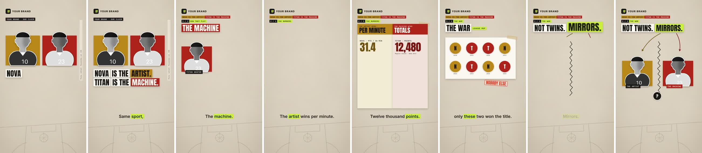

# editing

Claude Code skills for producing **voiceover-driven, paper-collage explainer reels** (1080×1920): cream paper,
black-and-white photo cutouts on mustard/red colour blocks, condensed headline strips, taped quote cards,
stat cards with rubber stamps, and karaoke captions, where every element pops in on the word that's being spoken.

The format was reverse-engineered from a 178-second Instagram sports-comparison reel; see
[`.claude/skills/explainer-script/references/playbook.md`](.claude/skills/explainer-script/references/playbook.md)
for the beat-by-beat breakdown.



## Skills

| Skill | What it does |
|---|---|
| [`explainer-reel`](.claude/skills/explainer-reel/SKILL.md) | Start here. The end-to-end pipeline from topic to MP4, cover and caption, with a QA checklist. |
| [`reel-breakdown`](.claude/skills/reel-breakdown/SKILL.md) | Analyzes any reference reel/short: contact sheets, motion strips, palette, pacing, loudness, transcript → style spec. |
| [`explainer-script`](.claude/skills/explainer-script/SKILL.md) | Angle, research with sources, beat structure, narration rules → `script.json` + post caption. |
| [`voiceover-timing`](.claude/skills/voiceover-timing/SKILL.md) | ElevenLabs TTS with word timestamps, or aligning your own recording; mastering to −14 LUFS. |
| [`photo-cutouts`](.claude/skills/photo-cutouts/SKILL.md) | Freely licensed photos from Wikimedia Commons with credits → B&W die-cut PNGs. |
| [`paper-collage-reel`](.claude/skills/paper-collage-reel/SKILL.md) | The Remotion template, design system and element library; compiles `script.json` → `timeline.json` and renders. |

In Claude Code, ask for it in plain words ("make a reel like this <link> about X vs Y") or call a skill directly, e.g. `/explainer-reel`.

## Pipeline

```
reference URL ─► reel-breakdown ─► style spec
topic ─► explainer-script ─► script.json ─┬─► photo-cutouts ─► public/img/*.png (+ credits)
                                          ├─► voiceover-timing ─► vo.mp3 + words.json
                                          └─► paper-collage-reel: build_timeline.py ─► timeline.json ─► Remotion ─► reel.mp4
```

## Quick start (demo, no audio or API keys needed)

```bash
cp -r .claude/skills/paper-collage-reel/template reels/demo && cd reels/demo && npm i
python3 ../../.claude/skills/paper-collage-reel/scripts/build_timeline.py examples/demo-script.json --estimate --out public/timeline.json
npx remotion studio                      # preview
npx remotion render Reel out/demo.mp4    # render
```

The demo uses fictional players, placeholder art and estimated timings to exercise every element type.

## Requirements

Node 20+, Python 3.10+, ffmpeg. Optional: `yt-dlp` (reference download), `faster-whisper` (alignment / transcripts),
`rembg` + `Pillow` (cutouts), an ElevenLabs API key (TTS). Bundled fonts are OFL/Apache licensed; see
`.claude/skills/paper-collage-reel/template/public/fonts/LICENSES.md`.

Reproduce the format, not someone else's video: use your own brand, script, research and properly licensed images.
